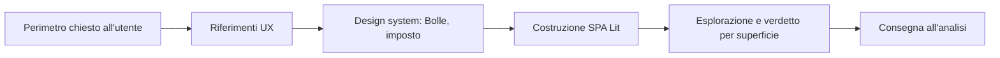
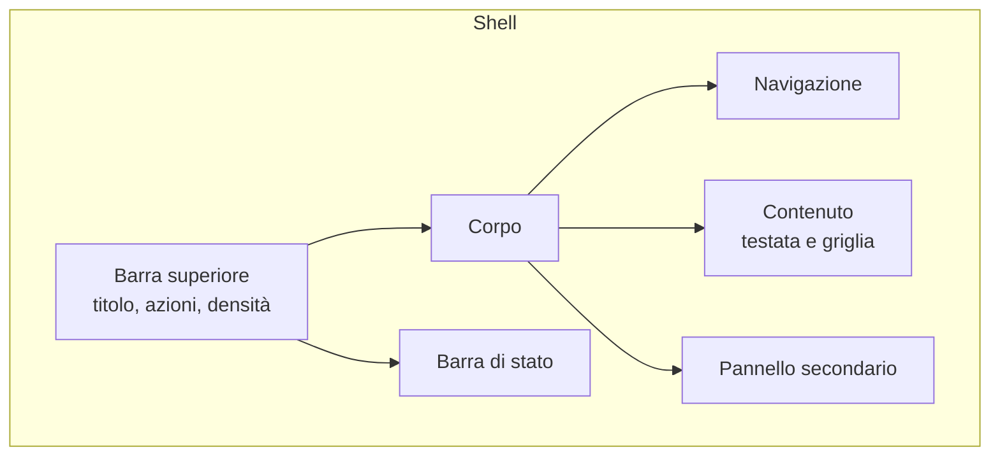
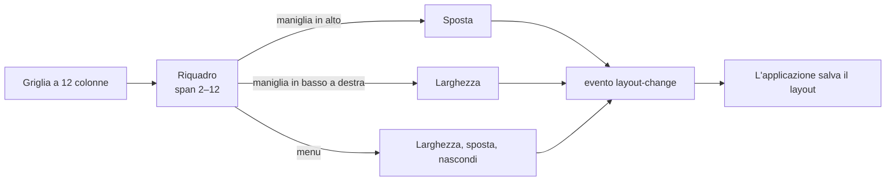
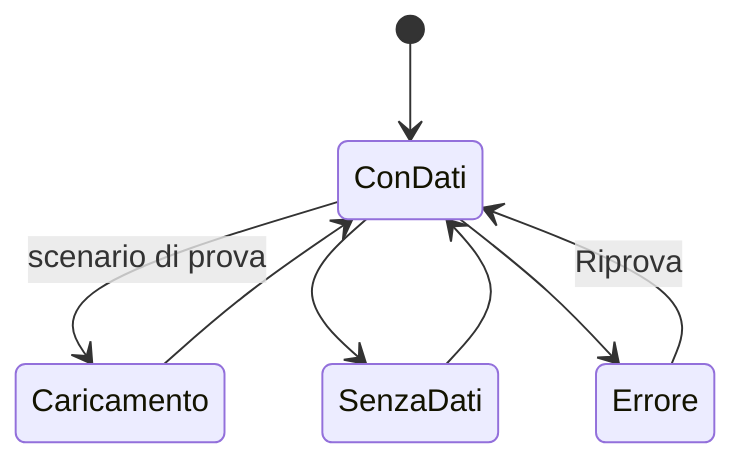
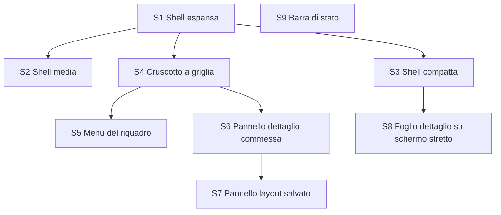

# Diagrammi del prototipo · shell e cruscotto

Prototipo: [prototype/app-shell](../../../prototype/app-shell/index.html). Diagrammi tratti da quello che il prototipo mostra.

## Flusso della fase

## Regioni e forme della shell

| Forma | Larghezza | Navigazione | Pannello secondario |
| --- | --- | --- | --- |
| `expanded` | ≥ 1240 px | sidebar estesa, 264 px | affiancato, 340 px |
| `medium` | 840–1239 px | sidebar compressa a rail | affiancato se aperto |
| `compact` | < 840 px | barra in basso con 4 voci, menu nella barra superiore | foglio laterale modale |

## Griglia e riquadri

## Stati dei riquadri

## Superfici

