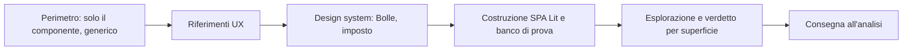
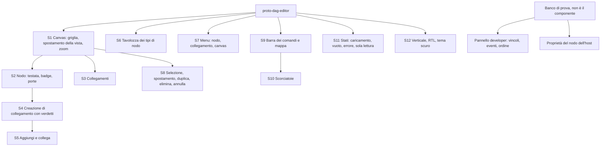
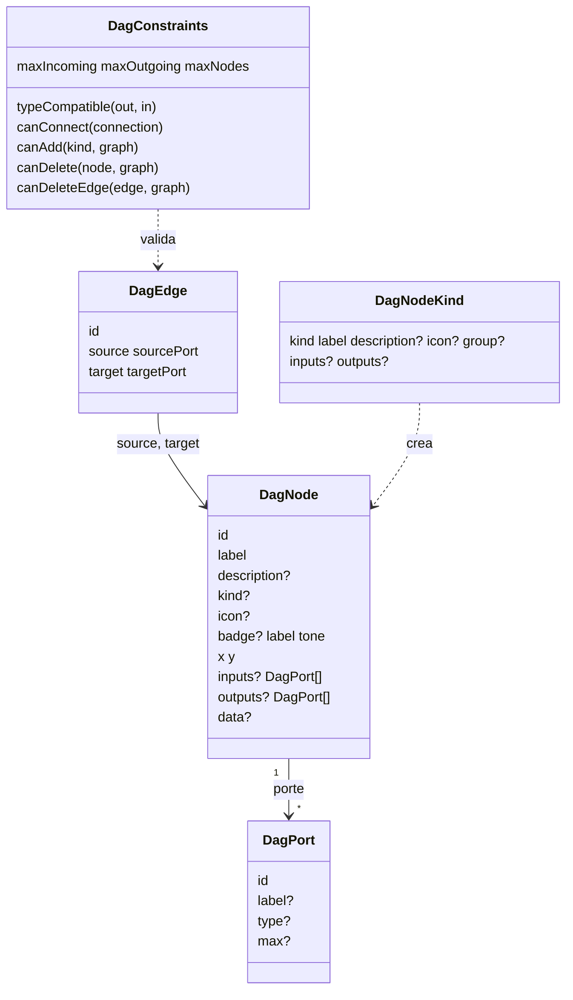
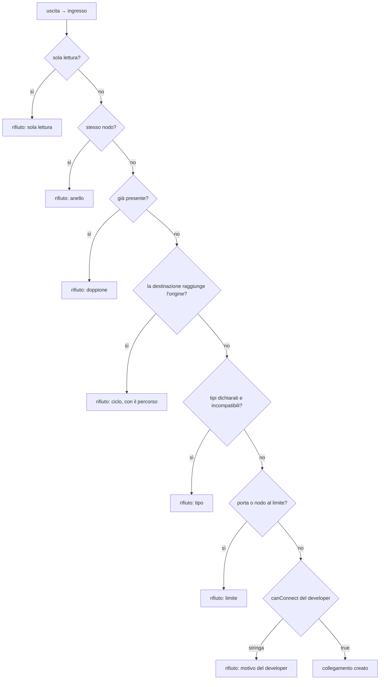
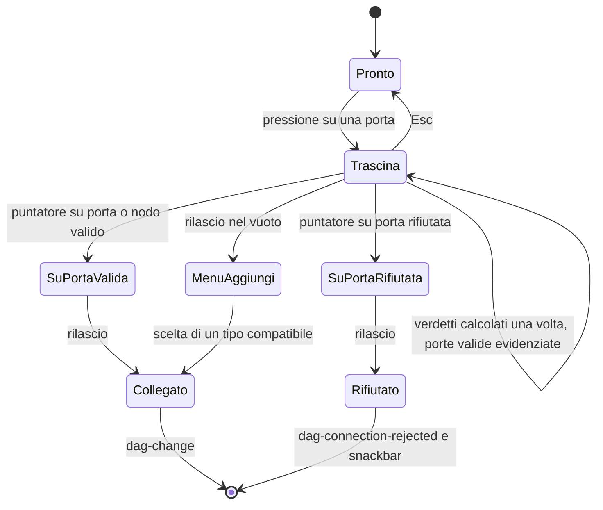
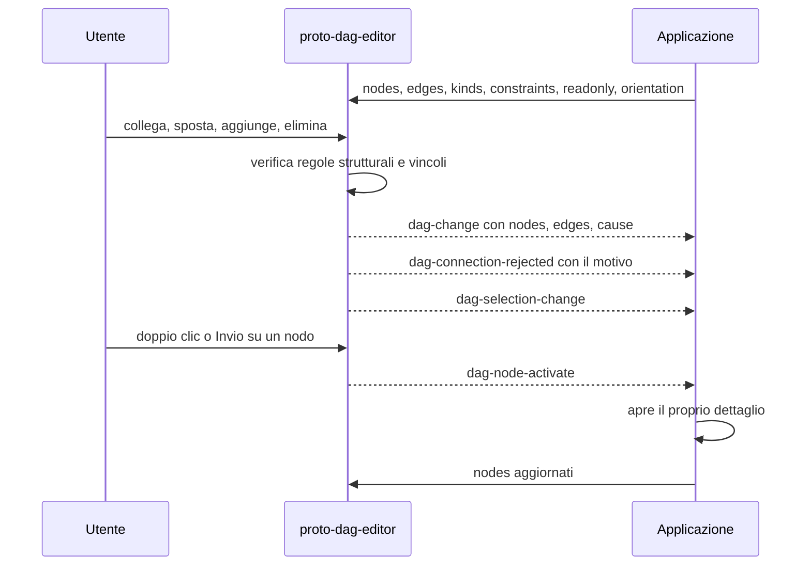

# Diagrammi del prototipo · grafo DAG

Prototipo: [prototype/dag](../../../prototype/dag/index.html). Diagrammi tratti da quello che il prototipo mostra.

## Flusso della fase

## Superfici

## Modello dati

Porte assenti: una porta generica d'ingresso e una d'uscita. Lista vuota: il nodo non riceve o non emette.

## Ordine dei controlli su un collegamento

Le prime quattro regole sono strutturali e sempre attive; le altre esistono solo se il developer le dichiara.

## Gesto di collegamento

## Componente e applicazione

