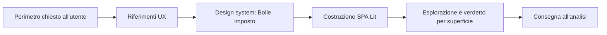
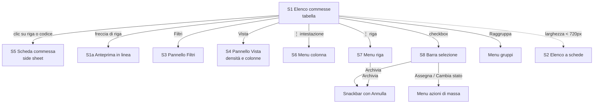
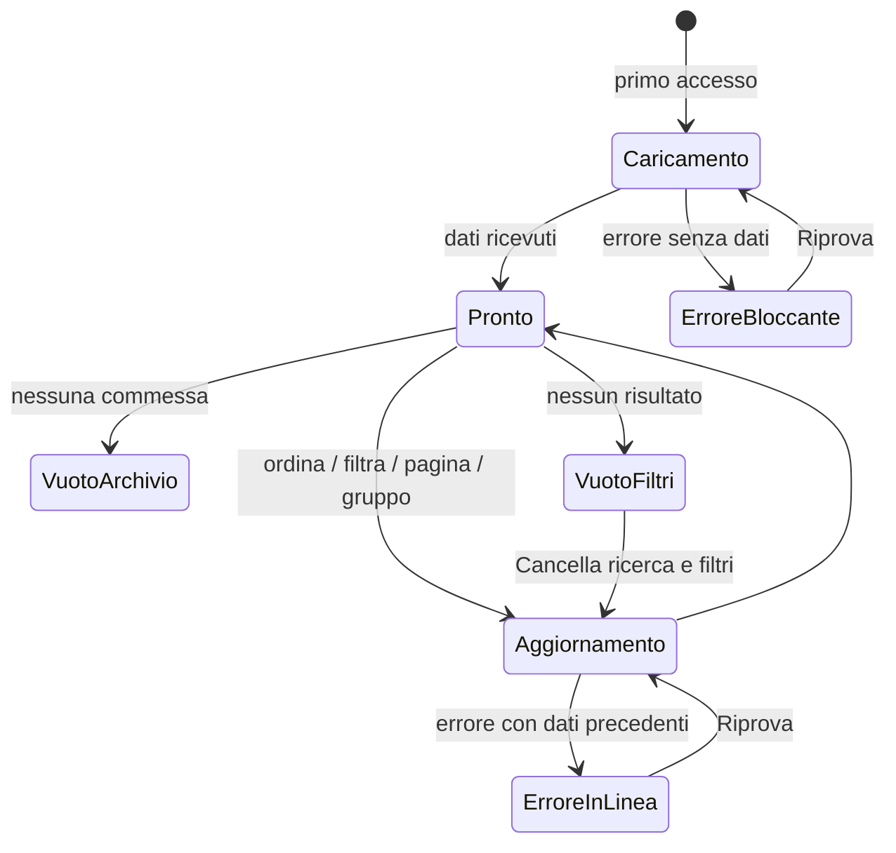
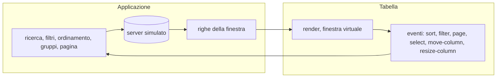

# Diagrammi del prototipo · tabella dati

Prototipo: [prototype/data-table](../../../prototype/data-table/index.html). Diagrammi tratti da quello che il prototipo mostra.

## Flusso della fase

## Superfici e navigazione

## Stati dell'elenco

## Chi calcola cosa

