# Diagrammi del prototipo · gantt

Prototipo: [prototype/gantt](../../../prototype/gantt/index.html). Diagrammi tratti da quello che il prototipo mostra.

## Flusso della fase

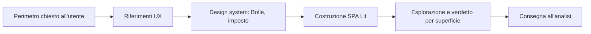

## Superfici

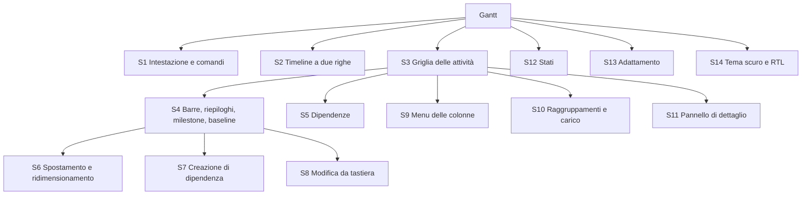

## Modello delle righe

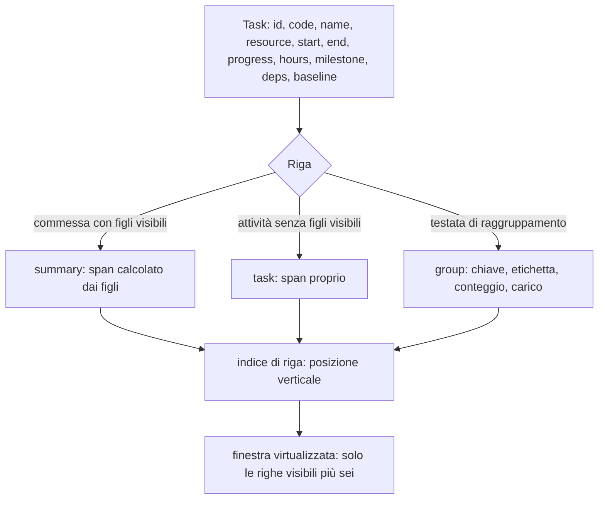

## Finestra di virtualizzazione

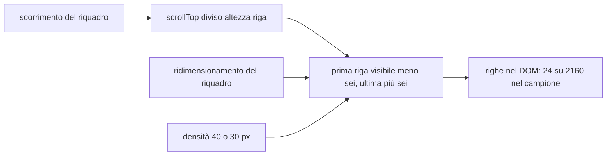

## Spostamento o ridimensionamento

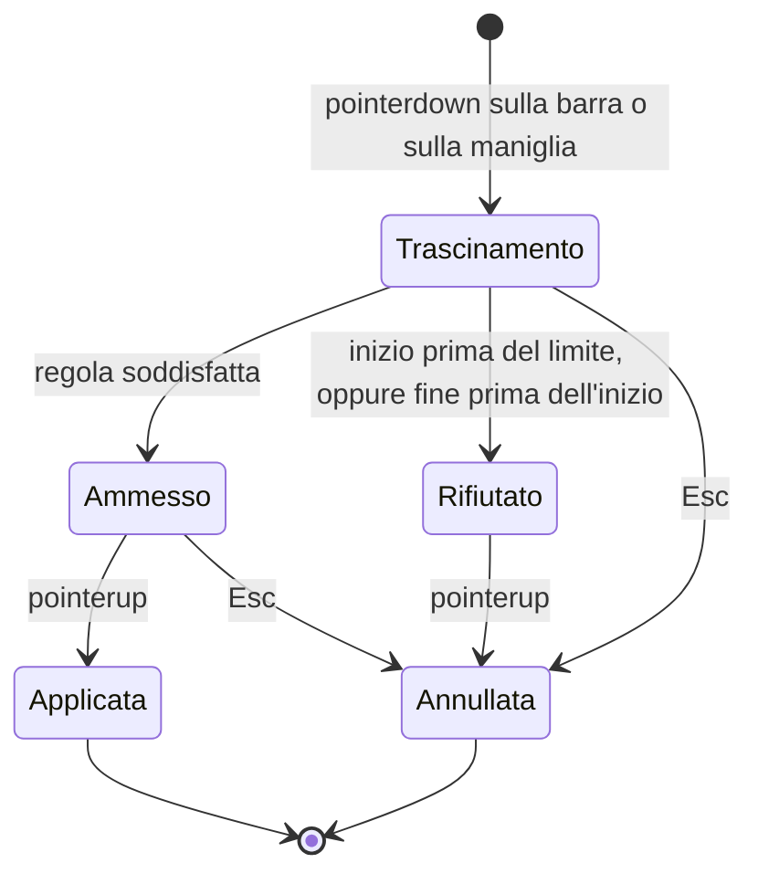

## Creazione di dipendenza

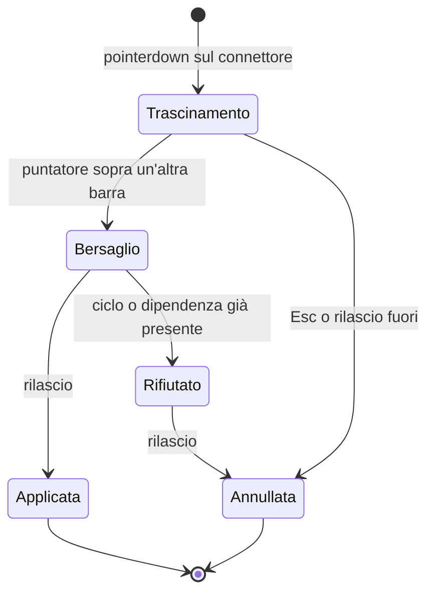

## Regole del prototipo

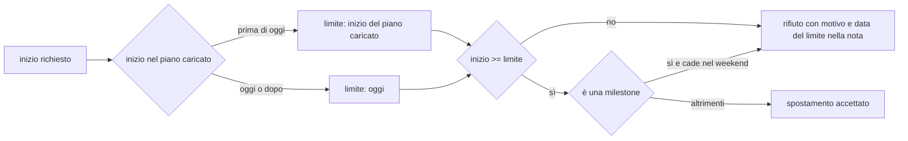

## Baseline

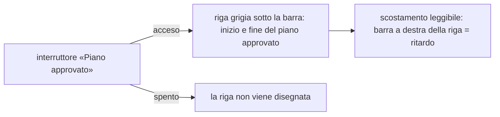

## Scala temporale

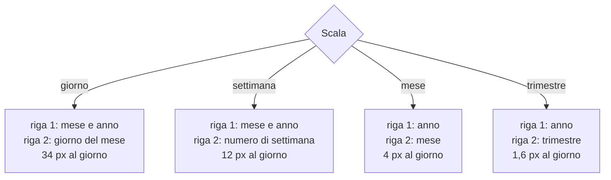

## Adattamento delle colonne

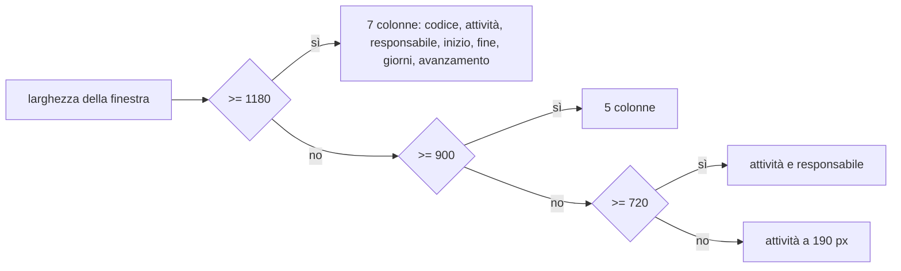

## Decisioni aperte

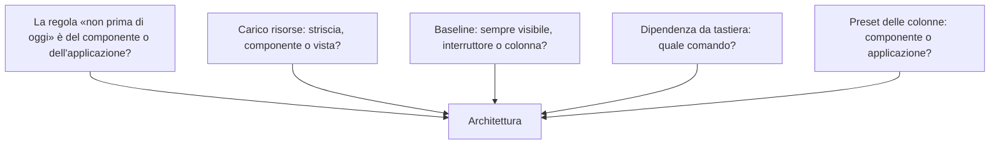
