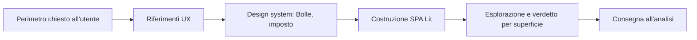
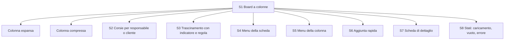
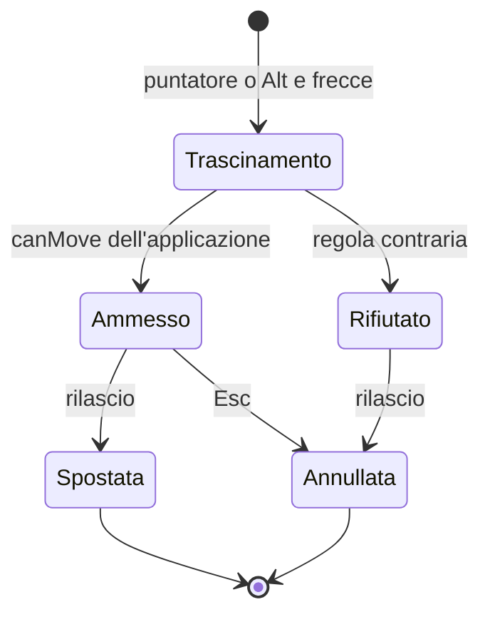
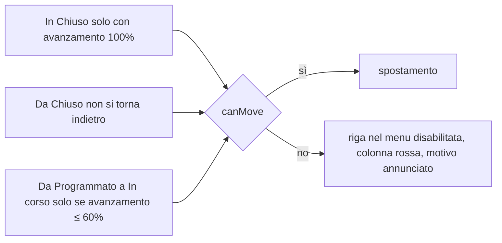
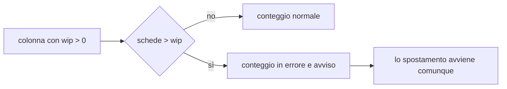

# Diagrammi del prototipo · kanban

Prototipo: [prototype/kanban](../../../prototype/kanban/index.html). Diagrammi tratti da quello che il prototipo mostra.

## Flusso della fase

## Superfici

## Spostamento di una scheda

## Regole del prototipo

## Limiti WIP

